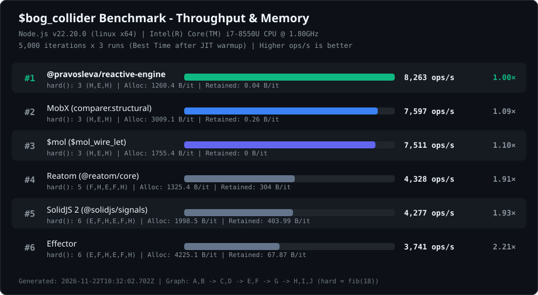

# Локальный бенчмарк на графе `$bog_collider`

Автоматически сгенерированный отчёт сравнения реактивных движков на графе из [`b-on-g/collider`](https://github.com/b-on-g/collider).



## Топология графа (ASCII-схема)

```text
        ┌─────────┐               ┌─────────┐
        │ Signal A│               │ Signal B│
        └────┬────┘               └────┬────┘
             │ \                     / │
             │  \                   /  │
             │   ▼                 ▼   │
             │  ┌───────────────────┐  │
             │  │    Computed C     │  │
             │  │  (A % 2 + B % 2)  │  │
             │  └────┬─────────┬────┘  │
             │       │         │       │
             ▼       ▼         │       ▼
         ┌───────────────┐     │  ┌───────────────────────────┐
         │  Computed E   │     │  │        Computed D         │
         │ hard(C+A+D[0])│     │  │ map({ x: i + A%2 - B%2 }) │
         └───────┬───────┘     │  └──┬──────────┬──────────┬──┘
                 │             │     │          │          │
       (только если C == 0)    │     │          │          ▼
                 │             │     │          │  ┌───────────────┐
                 │             │     │          │  │  Computed F   │
                 │             │     │          │  │ hard(D[2]||B) │
                 │             ▼     ▼          │  └───────┬───────┘
                 │      ┌──────────────────┐    │          │
                 └─────►│    Computed G    │◄───┼──────────┤
                        │ C+(C||E%2)+D[4]+F│    │          │
                        └────┬────────┬────┘    │          │
                             │        │         │          │
                             ▼        ▼         │          ▼
                        ┌────────┐ ┌────────┐   │     ┌────────┐
                        │Effect H│ │Effect I│   │     │Effect J│
                        │hard(G) │ │  (G)   │   │     │hard(F) │
                        └────────┘ └────────┘   │     └────────┘
```

* **Ленивое ветвление (`C || E % 2`):** Когда `C` истинно, узел `G` не читает `E`, поэтому дорогое вычисление `hard()` в `E` должно пропускаться.
* **Структурное гашение (`D`):** Узел `D` при каждом пересчёте создаёт новый массив объектов `{ x }`. При неизменном содержимом массива компаратор `equals` блокирует лишний пересчёт `F` и `J`.

## Параметры стенда

* **Дата замера:** 27 нояб. 2026 г., 17:46
* **Среда:** Node.js `v22.20.0` (`linux x64`)
* **Процессор:** `Intel(R) Core(TM) i7-8550U CPU @ 1.80GHz`
* **Нагрузка:** `5 000` двухшаговых итераций × `3` контрольных прогона (учитывается минимальное время после JIT-прогрева)
* **Артефакты:** [`./results/last-benchmark.json`](./results/last-benchmark.json) · [`./results/last-benchmark.svg`](./results/last-benchmark.svg)

## Сводная таблица результатов

| Rank | Engine | `hard()` calls | Best Time (ms) | ops/sec | Alloc (B/iter) | Net Alloc (B/iter) | Retained (B/iter) | Ratio |
| :---: | :--- | :---: | :---: | :---: | :---: | :---: | :---: | :---: |
| **1** | **@pravosleva/reactive-engine `v3.0.5`** | `3 (H,E,H)` | `589.93` | `8476` | `305.1` | `76.2` | `0.022` | `1.00×` |
| **2** | @angular/core (Signals) `v22.3.0` | `3 (H,E,H)` | `594.56` | `8410` | `578.3` | `357.5` | `0.026` | `1.01×` |
| **3** | @vue/reactivity `v3.5.46` | `3 (H,E,H)` | `647.28` | `7725` | `426` | `164.9` | `0.029` | `1.10×` |
| **4** | MobX (comparer.structural) `v7.1.7` | `3 (H,E,H)` | `677.26` | `7383` | `219.6` | `0` | `0.384` | `1.15×` |
| **5** | $mol ($mol_wire_solo) `v1.0.1855` | `3 (H,E,H)` | `724.08` | `6905` | `1670.9` | `1409.7` | `0.000` | `1.23×` |
| **6** | Reatom (@reatom/core) `v1001.3.0` | `3 (H,E,H)` | `741.57` | `6742` | `414.2` | `138.4` | `336.029` | `1.26×` |
| **7** | SolidJS 2 (@solidjs/signals) `v2.0.4` | `4 (E,H,E,H)` | `941.39` | `5311` | `1364.1` | `741.8` | `381.259` | `1.60×` |
| **8** | alien-signals `v3.2.1` | `5 (F,H,E,F,H)` | `1044.4` | `4787` | `796.6` | `537.5` | `0.029` | `1.77×` |
| **9** | @preact/signals-core `v1.14.5` | `5 (F,H,E,F,H)` | `1045.64` | `4782` | `375.7` | `117.3` | `0.029` | `1.77×` |
| **10** | Svelte 5 (Runes) `v5.59.2` | `5 (F,H,E,F,H)` | `1182.53` | `4228` | `6498.4` | `5896.9` | `5600.046` | `2.00×` |
| **11** | Effector `v23.5.2` | `6 (E,F,H,E,F,H)` | `1298.56` | `3850` | `1765.9` | `1506.1` | `67.877` | `2.20×` |

## Легенда колонок

* **`hard() calls`** — количество и порядок вызовов `fib(18)` за одну двухшаговую итерацию. Теоретический минимум — `3 (H,E,H)` (пропуск невостребованной ветки `E` на первом шаге и отсечение пересчёта `F` при неизменном содержимом массива `D`).
* **`Best Time (ms)`** — минимальное время выполнения `5 000` итераций из `3` прогонов после JIT-прогрева V8 (меньше — лучше).
* **`ops/sec`** — пропускная способность в полных двухшаговых итерациях в секунду (больше — лучше).
* **`Alloc (B/iter)`** — объём временных аллокаций в куче V8 за одну итерацию до сборки мусора (включает пересоздание массива из 5 объектов в узле `D` и внутренние структуры планировщика движка).
* **`Retained (B/iter)`** — остаточный прирост памяти в пересчёте на итерацию после принудительного двойного `global.gc()`. Значения `< 0.500 B/iter` соответствуют нулевой утечке (фоновый шум служебных структур V8), значения `> 50 B/iter` указывают на удержание промежуточных данных в памяти.
* **`Ratio`** — отношение `Best Time` текущего движка к лучшему результату в таблице (`1.00×` — лидер прогона).

## Методология и V8 JIT

1. **Прогрев JIT:** Перед замером каждый движок выполняет 500 прогревочных итераций, чтобы V8 перевёл горячие функции в оптимизированный машинный код (*Maglev / TurboFan*) и стабилизировал скрытые классы (*Hidden Classes*).
2. **Минимум из 3 прогонов (`Best Time`):** Выбор лучшего времени из серии отсекает случайные прерывания планировщика ОС и фоновый троттлинг CPU.
3. **Замер памяти (`--expose-gc`):**
   * `Alloc (B/iter)` — объём временных аллокаций в куче V8 за одну итерацию до вызова сборщика мусора.
   * `Retained (B/iter)` — остаточное удержание памяти после принудительного двойного вызова `global.gc()`.
4. **Запуск стенда:**
   ```bash
   bash bench.sh
   ```

## Запуск стенда `bench.sh`

Скрипт `bench.sh` автоматизирует весь цикл: установку зависимостей, прогрев V8 JIT, прогон замеров (`run.mjs`) и генерацию отчётов (`./results/last-benchmark.json`, `./results/last-benchmark.svg`, `./results/last-benchmark.png` и `README.md`).

```bash
bash bench.sh
```

При первом запуске (если отсутствует `node_modules`) скрипт автоматически установит пакеты из `package.json` (при недоступности сети сработает оффлайн-фолбэк из локального кэша). При повторных запусках шаг установки пропускается.

### Поддерживаемые флаги

| Флаг | Описание |
| :--- | :--- |
| `--install` | Обнуляет `node_modules` и принудительно переустанавливает зависимости по версиям из `package.json` / `package-lock.json`. |
| `--update` | Удаляет `node_modules` и `package-lock.json`, загружает самые свежие версии (`@latest`) всех пакетов из npm и обновляет `package.json`. |
| `--local` | Подключает локальную сборку `@pravosleva/reactive-engine` из соседнего репозитория (`~/projects/reactive-engine/dist`) через симлинк вместо пакета из npm. |

Флаги можно комбинировать в любом порядке:

```bash
bash bench.sh --update --local
```

### Где заканчивается погрешность замеров и начинается реальная просадка

Отклонение до `~10 μs/it` (`Ratio ≤ 1.08×`) находится строго в пределах погрешности замеров, а до `~20 μs/it` (`Ratio ≤ 1.18×`) остаётся практически несущественным в реальных приложениях.

Поскольку один вызов `fib(18)` на стенде занимает около `35–45 μs`, порог в `30 μs/it` работает как точный математический фильтр:
- В серой (`< 10 μs`) и янтарной (`10–30 μs`) зонах остаются только те движки, которые уложились в теоретический минимум 3 вызова `hard()` (`H`, `E`, `H`). Их разброс между собой — это исключительно разница в накладных расходах самого планировщика и сравнения структур.
- В красную зону (`> 30 μs`) автоматически попадают все библиотеки, которые допустили хотя бы один лишний вызов `hard()` (`4`, `5` или `6` вызовов вместо `3`) — то есть не смогли отсечь невостребованную ветку `E` или погасить пересчёт при неизменном массиве `D`.

_Это делает цветовую индикацию на диаграмме более осмысленной: она мгновенно отделяет **архитектурно оптимальное вычисление графа** от **лишней работы**._

### Как интерпретировать метрики памяти (`Alloc`, `Net Alloc` и `Retained`)

* **`Alloc (B/iter)`** — общие временные аллокации в куче V8 (Young Generation) за одну двухшаговую итерацию до вызова сборщика мусора, включая пересоздание массивов `numbers.map(...)` внутри самого теста (~400–500 байт/итерация).
* **`Net Alloc (B/iter)`** — **чистые накладные расходы самого реактивного движка** (`Alloc` за вычетом базового следа `baseline` без реактивности). Отражает стоимость работы планировщика, пересборки зависимостей и замыканий на один тик графа.
* **`Retained (B/iter)`** — остаточная память в куче V8 после двойного принудительного вызова `global.gc()`. **Значения `< 0.500 B/iter` соответствуют отсутствию утечек памяти; более высокие значения указывают на накопление кэшей или истории внутри графа.**
